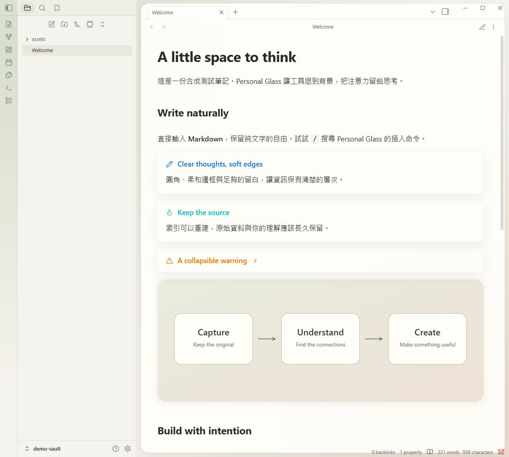
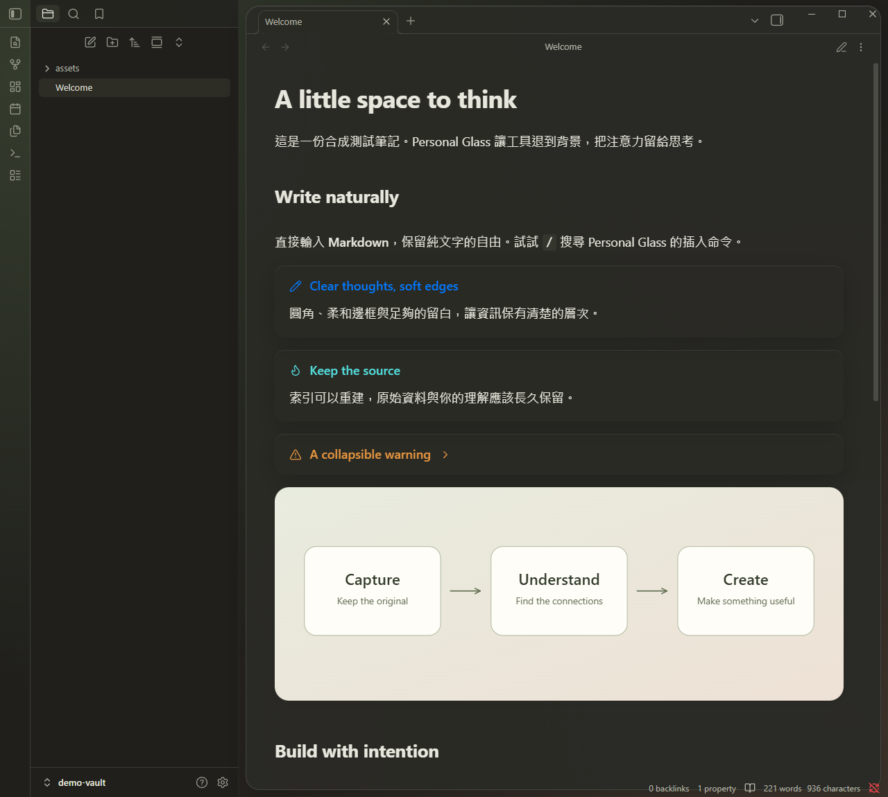

# Personal Glass

[](https://github.com/linarthurlin/obsidian-personal-glass/actions/workflows/ci.yml)

A standalone Obsidian theme and a small companion plugin for rounded glass surfaces and keyboard-first Markdown editing. Original code, MIT licensed. Development prerelease.

Actual Obsidian screenshots using only the synthetic demo vault (Portable mode):

| Light | Dark |
| --- | --- |
|  |  |

## What works

- Three paired light/dark palettes: Warm Neutral, Mineral and Rose Stone.
- Focus, Glass and Portable surfaces. The theme works without the plugin.
- Rounded panels, Callouts, images, code blocks and menus; visible keyboard focus, print and accessibility fallbacks.
- Companion settings for palette, surface, content width, image corners and reduced motion.
- 14 commands for headings, lists, tasks, quotes, Callouts, dividers, code, math and tables.
- Experimental Windows Mica/Acrylic through Electron's native window API, explicitly opt-in and off by default.
- Shared token adapter for the optional [Crisp Craft](https://github.com/letschips/crisp-craft) Reading View plugin.

This does not implement Apple's Liquid Glass renderer or replace Obsidian's editor. Native materials require Windows 11 22H2+, a compatible Electron runtime and the hidden/Obsidian window frame. The OS can use a solid fallback. Portable mode uses an in-app gradient and does not expose other desktop windows.

## Install

Download assets from [Releases](https://github.com/linarthurlin/obsidian-personal-glass/releases).

1. Extract `personal-glass-theme-<version>.zip` into `<vault>/.obsidian/themes/Personal Glass/`.
2. Select **Personal Glass** in Settings → Appearance → Themes.
3. Optionally extract `personal-glass-plugin-<version>.zip` into `<vault>/.obsidian/plugins/personal-glass/`.
4. Reload Obsidian and enable Personal Glass in Community plugins. Configure appearance under its settings.
5. Use **Live Preview** for inline Markdown rendering. Enable the core **Slash commands** plugin and type `/`, then search for `Personal Glass` or a command name.

The root `manifest.json` and root release assets describe the companion plugin, so BRAT can use `linarthurlin/obsidian-personal-glass` when prerelease installation is supported. Install the theme ZIP separately. This project has not been submitted to the Obsidian community directory.

Plugin controls require the Personal Glass theme for visual effects. Commands work independently. The plugin does not change the selected theme, scan notes, call AI services or send telemetry. Do not run another native-material plugin at the same time.

## Develop

Node.js 22.12+ and npm are required.

```sh
npm ci
npm run check
npm run package
npm run preview
```

`dist/theme` and `dist/plugin` contain installable builds. `release` contains ZIPs, plugin release assets and checksums. The preview is a synthetic HTML fixture, not a substitute for in-app testing.

Install builds into an explicitly selected existing vault:

```sh
npm run install:vault -- --vault /absolute/path/to/test-vault
```

The installer copies only five distribution files, backs up replaced files locally and preserves notes, `appearance.json`, `community-plugins.json` and plugin `data.json`. It does not activate anything. Start with the included synthetic `demo-vault`, then test your daily vault after reviewing the appearance.

## Versioning and CI/CD

- `main`: development; use feature branches and PRs for changes.
- Every push/PR runs type checking, Markdown/native lifecycle tests, installer isolation tests, CSS/manifest validation and packaging on Linux and Windows.
- Tags use `x.y.z`, matching `package.json` and both manifests (no leading `v`).
- The release workflow reruns checks on both OSes and publishes a GitHub prerelease only after both pass.
- Dependabot checks npm dependencies weekly and pinned GitHub Actions monthly.
- CI/CD produces release assets; it never deploys into a user's vault.

```sh
npm version patch --no-git-tag-version
npm run version:sync
npm run check
git add package.json package-lock.json manifest.json theme/manifest.json versions.json docs/release-notes.md
git commit -m "chore: release next version"
# Create and push a tag matching the new version after reviewing the commit.
```

## Next milestones

See [ROADMAP](docs/ROADMAP.md) for Windows material testing, editor polish, SVG authoring and the separate Agent knowledge workflow. No AI ingestion or automatic vault organization ships in 0.1.0.

See [testing](docs/TESTING.md), [installation and rollback](docs/INSTALLATION.zh-TW.md) and [design references](docs/REFERENCES.md).
